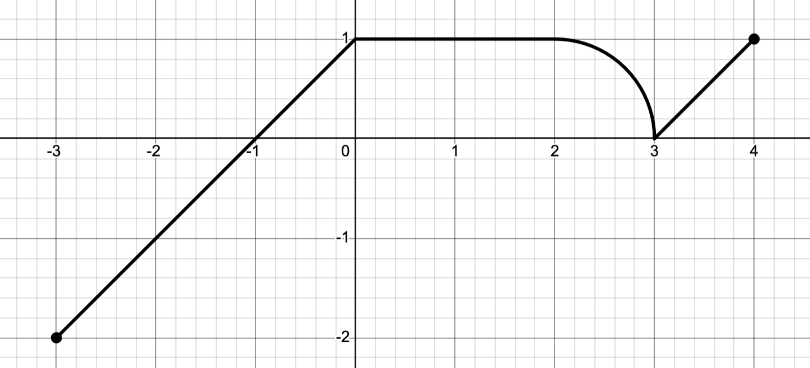

Here are a few practice problems for integration

## The problems

1. Evaluate the following definite and indefinite integrals.

   a. $\displaystyle \int_0^2 (x^2 + 2x) \, dx$
   \vspace{1mm}
   b. $\displaystyle \int (x + 2e^x + 3\sin(x) + 4\sin(x)) \, dx$
   \vspace{1mm}
   c. $\displaystyle \int_{-1}^{1} (x^5 - x^3) \, dx$

2. Write down the left and right Riemann sums with $n=8$ terms for the integral

   $$\int_1^5 \cos(x^2) \, dx.$$
   

3. The complete graph of a function $f$ is shown in @fig-int_graph; it consists of three line segments and a quarter circle. Evaluate
$$\int_{-3}^4 f(x) \, dx.$$

{fig-alt="The figure for problem 3" #fig-int_graph}