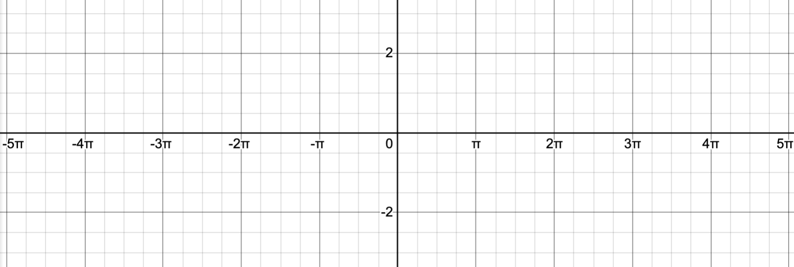
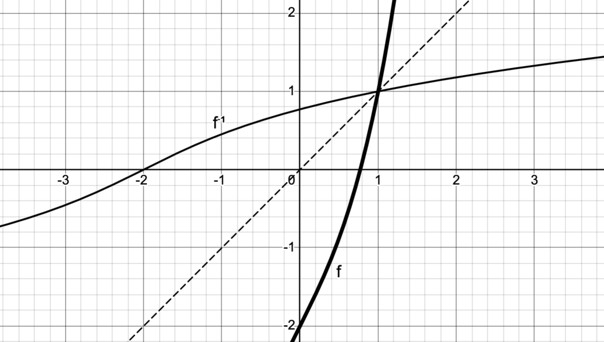

<!-- \vspace{-0.5in} -->

Here are a few more practice problems for our second exam this Friday.

1. Use the differentiation rules to compute the derivatives of the following functions.  
   a) $\displaystyle f(x) = x^4 \, 4^x$
   b) $\displaystyle f(x) = \arcsin(x^3) + \arctan(4x)$

2. Use logarithmic differentiation to find the derivatives of the following functions:
   a) $\displaystyle f(x) = \frac{2^x (x+2)^8}{\sqrt{x^2+2}}$
   b) $f(x) = x^{x^2}$

3. Use the fact that $\displaystyle \lim_{\theta\to0} \sin(\theta)/\theta = 1$ to compute 
   $$ \lim_{x\to0}\frac{\sin(5x)}{3x}.$$

4. Supposing that $f$ is a differentiable. Use the definition of the derivative to show that

   $$\frac{d}{dx} x\,f(x) = f(x)+x\,f'(x).$$

5. Sketch the graph of 
   $$f(x) = 2\sin\left(\frac{1}{4} x\right)$$
   on the axes provided in @fig-axes. 
   Be sure to clearly indicate the $x$ and $y$ intercepts, as well as the maximum and minimum values.

6. The graph of $f(x)=x^{3}+2x-2$, together with its inverse and the line $y=x$, is shown in @fig-inverse. Evaluate $(f^{-1})'(-2)$.

\newpage 

## Figures 

::: {style="max-width: 450px; margin: 0 auto"}
{#fig-axes}
:::

::: {style="max-width: 450px; margin: 0 auto"}
{#fig-inverse}
:::
