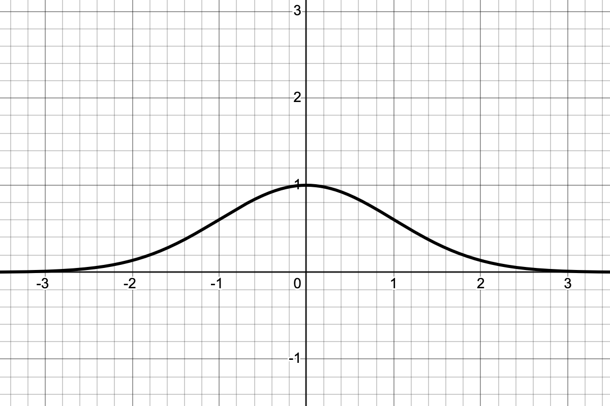
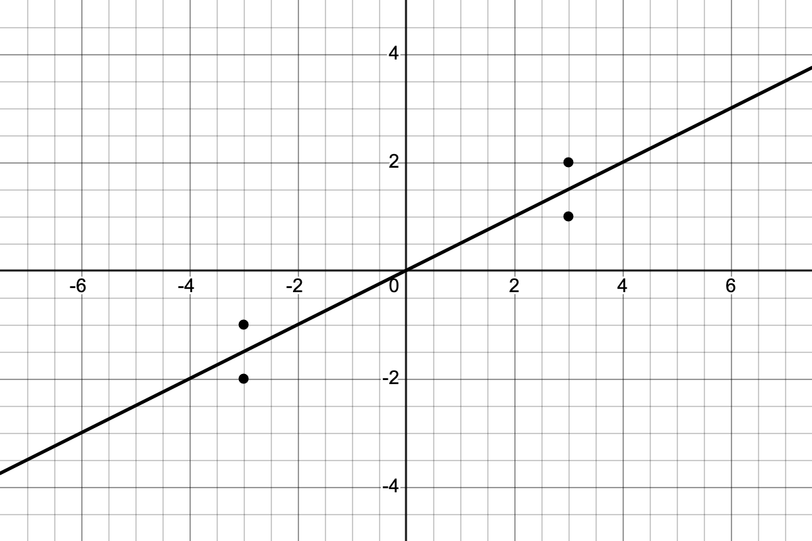
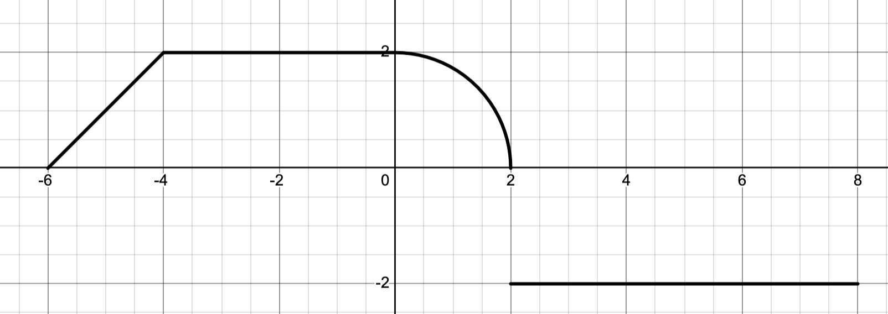

Here are a few more practice problems for our last midterm this Friday, November 20th.

## Problems 

2. The graph of $f(x) = e^{-x^2/2}$ is shown in @fig-normal_inflection. Find the exact coordinates of any inflection point that you see.

3. I've got $1200\,\text{cm}^2$ of material to build a box with a square base and an open top. What is the volume of the largest box that I can build? What are the dimensions of that box?

<!-- -->

5. @fig-regress shows the data 
$$\{(-3,-2),(-3,1),(3,-1), (3,2)\},$$
together with its regression line of the form $f(x)=ax$.

   a. Write down the formula for $E(a)$ representing the squared error of the regression as a function of the parameter $a$.
   b. Find the value of $a$ that minimizes that squared error.

6. Write down a right Riemann sum for 
$$
\int_0^3 x^2 \, dx
$$
using $n=30$ terms. Do you think that your estimate is an upper bound or a lower bound for the actual value?

7. The complete graph of a function $f$ is shown in @fig-piecewise_integral; it consists of three line segments and a quarter circle. Evaluate 
$$
\int_{-6}^8 f(x) \, dx.
$$

<!-- -->

9. Evaluate the following definite and indefinite integrals.

    b. $\displaystyle \int \frac{x^4 - x^3 + x^2 - 1}{x^2} \, dx$
    c. $\displaystyle \int x e^{-x^2} \, dx$
    d. $\displaystyle \int_0^{3} (x^2 + 1) \, dx$
    e. $\displaystyle \int_0^{3} x\sqrt{x^2 + 1} \, dx$

\newpage

\vspace{-1in}

## Figures 

::: {style="max-width: 450px; margin: 0 auto;"}
{#fig-normal_inflection .responsive-raster width=400px fig-pos="H" fig-alt="The graph of $f(x) = e^{-x^2/2}$"}
:::

::: {style="max-width: 450px; margin: 0 auto"}
{#fig-regress .responsive-raster width=400px fig-pos="H" fig-alt="A little data together with its regression line"}
:::

::: {style="max-width: 450px; margin: 0 auto"}
{#fig-piecewise_integral .responsive-raster width=400px fig-pos="H" fig-alt="The complete graph of a function"}
:::

