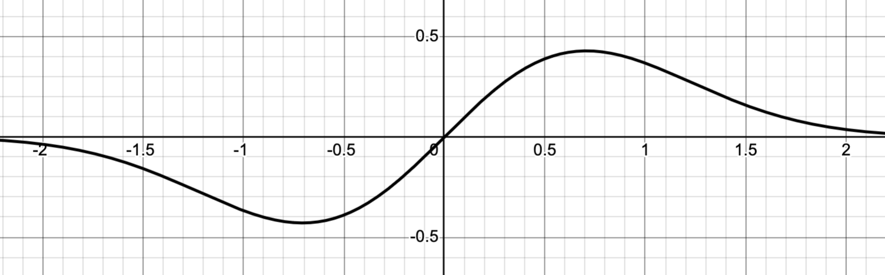

\vspace{-0.4in}

Here are a few more practice problems for our next quiz this Friday.

## Problems 

1. We'd like to generate a rational approximation to $\sqrt{8}$. To do so, let $f(x) = x^2 - 8$ and let $x_0=1$. Then,

   a. Write down the corresponding Newton'd method iteration function for $f$.
   b. Compute two Newton steps from $x_0=1$.

2. @fig-exponential-graph shows the graph of $f(x) = x\,e^{-x^2}$. Find the exact locations of any inflection points that you see.

3. I've got 1000 meters of fence to build a corral. The corral will be partitioned into three pieces and built against an existing wall as shown in @fig-corral. What is the maximal total area that I can enclose?

\newpage 

## Figures

{#fig-exponential-graph width=100% fig-alt="Graph of f(x) = x exp(-x squared)"}

::: {.content-visible when-format="html"}

{#fig-corral width=100% fig-alt="A corral partitioned into three pieces"}

:::

::: {.content-visible when-format="pdf"}

{#fig-corral width=100% fig-alt="A corral partitioned into three pieces"}

:::
