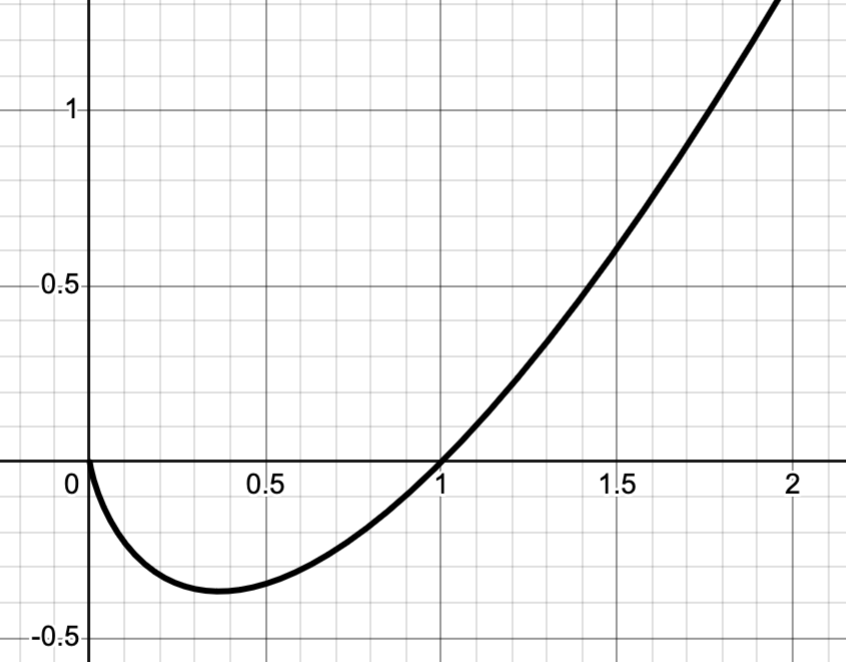
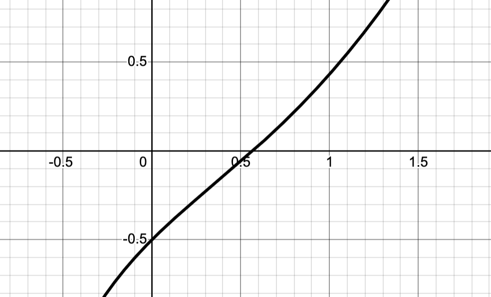
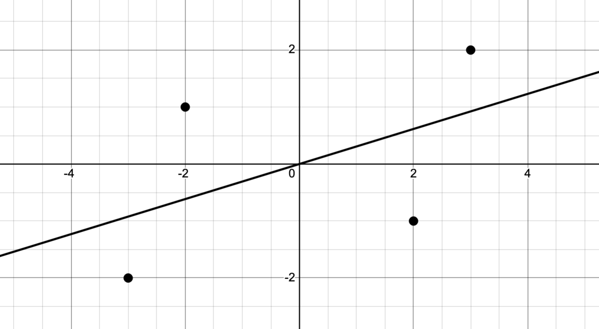
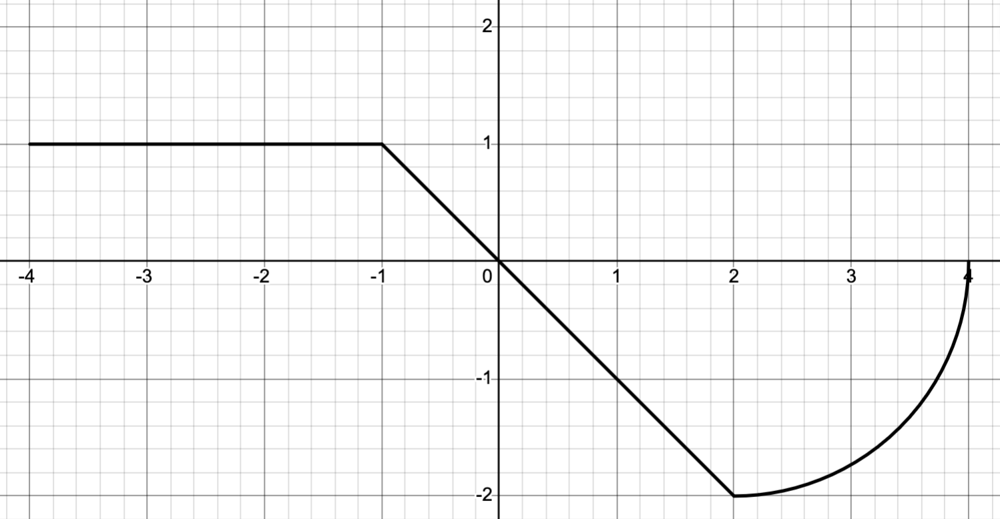

We have our last midterm this coming Friday, November 20th. The problems on the exam will be very much like the problems you see here. I will go over this problem sheet in class on Wednesday but it will help you immensely to think about it on your own first so *please* work it out to the best of your ability prior to meeting on Wednesday.


## Problems 

1. The graph of $f(x) = x\ln(x)$ is shown in figure @fig-xlogx. Find the exact location of the global minimum.

2. The graph of $f(x) = (x^2 - e^{-2x})/2$ is shown in @fig-mystery_inflection. Find the exact coordinates of any inflection point that you see.

3. I need to build a box with a square base and no top that needs to hold 500 $\text{cm}^3$. What's the minimal surface area required to accomplish this?

4. Let $f(x) = x^3 - 8$. 

   - Write down the Newton's method iteration function $N(x)$ for $f$.
   - Apply $N(x)$ to take two Newton steps from $x_0 = 1$.

5. @fig-regress shows the data 
$$\{(-3,-2),(-2,1),(2,-1), (3,2)\},$$
together with its regression line of the form $f(x)=ax$.

   a. Write down the formula for $E(a)$ representing the squared error of the regression as a function of the parameter $a$.
   b. Find the value of $a$ that minimizes that squared error.

6. Write down both right and left Riemann sums for 
$$
\int_0^2 e^x \, dx
$$
using $n=4$ terms. Which is an upper bound and which is a lower bound for the actual value?

7. The complete graph of a function $f$ is shown in @fig-piecewise_integral. Evaluate 
$$
\int_{-4}^4 f(x) \, dx.
$$

8. An object is thrown off a $90$ ft tall cliff with an initial vertical velocity of $20$ ft/s. Find the function $y(t)$ that describes the height of the object as a function of time $t$.

\newpage

9. Evaluate the following definite and indefinite integrals.

    a. $\displaystyle \int (x^2 + e^x - \sin(x) + \cos(x)) \, dx$
    b. $\displaystyle \int \frac{x^3 +x^2 + x + 1}{x^2} \, dx$
    c. $\displaystyle \int x\sin(x^2+1) \, dx$
    d. $\displaystyle \int_0^{2} (x^2 + 1) \, dx$
    e. $\displaystyle \int_0^{2} x\sqrt{x^2 + 1} \, dx$

10. Suppose that $f$ is a continuous function and let $a,b$, and $s$ be a real numbers. Show that
$$\int_a^b f(x-s) \, dx = \int_{a-s}^{b-s} f(u) \, du.$$


## Figures 

::: {style="max-width: 550px; margin: 0 auto"}
{#fig-xlogx .responsive-raster width=550px fig-alt="The graph of $f(x) = x\ln(x)$"}
:::

::: {style="max-width: 550px; margin: 0 auto;"}
{#fig-mystery_inflection .responsive-raster width=550px fig-alt="The graph of $f(x)=(x^2 - e^{-2x})/2$" frameborder=0} 
:::

::: {style="max-width: 550px; margin: 0 auto"}
{#fig-regress .responsive-raster width=550px fig-alt="A little data together with its regression line"}
:::

::: {style="max-width: 550px; margin: 0 auto"}
{#fig-piecewise_integral .responsive-raster width=550px fig-alt="The complete graph of a function"}
:::


::: {.content-visible when-format="html"}

## Questions

If you'd like to ask a question about or reply to a question on this sheet, you can do so by pressing the "Reply on Discourse" button below.

```{ojs}
embedDiscourseMathTopic(2898)
```

```{ojs}
import {embedDiscourseMathTopic} from '/components/EmbedDiscourseMathTopics/embedDiscourseMathTopic.js';
```

:::
